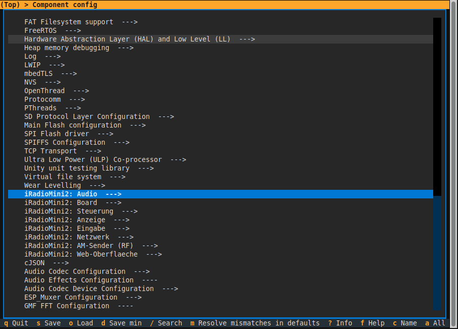

# iRadioMini2

Baukasten für ESP32-Internetradios auf **ESP-IDF 6.1** – Neuaufbau von iRadioMini (ESP-IDF 4.x / ESP-ADF 2.x https://github.com/radiolab81/iRadioMini).
Streaming (HTTP/HTTPS, MP3/AAC/…), Mediaplayer von SD-Karte, KiwiSDR-support, PCM-Audio-RX, 10-Band-Equalizer, Web-UI/REST-API, Taster und Drehgeber, austauschbare Anzeige-Backends.

## Schnellstart

```bash
. $IDF_PATH/export.sh            # ESP-IDF v6.1
idf.py set-target esp32
idf.py menuconfig                # Menü "iRadioMini2: ..." (Board, Pins, Display, WLAN-Fallback, Web)
idf.py build flash monitor
```


Abhängigkeiten (ESP-GMF, `esp_codec_dev`, `cjson`, bei Bedarf `u8g2` bzw. LVGL) lädt der Component Manager automatisch.
Display-spezifische Pakete werden nur geladen, wenn die Anzeige in `menuconfig` gewählt ist. Nach dem Wechsel der Anzeige normalerweise
einfach erneut bauen; falls das Paket fehlt: `idf.py reconfigure`. Die SSD1306-Anzeige bezieht `u8g2` als Git-Abhängigkeit,
daher muss `git` im `PATH` der Shell liegen, in der `idf.py` läuft.

Auf die SD-Karte (FAT) kopieren: `playlist.m3u` (siehe `examples/playlist.m3u`), optional `kiwi.m3u` für KiwiSDR (siehe `examples/kiwi.m3u`) und optional `wifi.txt`
(siehe `examples/wifi.txt`). Die WLAN-Daten werden beim ersten Start in den NVS übernommen.
Reihenfolge der Zugangsdaten: `wifi.txt` > NVS > Kconfig-Fallback.

**KiwiSDR-Quelle und Serversuche:** Der Bereich „KiwiSDR-Server suchen“ im Web-UI erscheint nur im Modus *KiwiSDR*. Dieser Modus ist nur wählbar, wenn mindestens ein Eintrag existiert – lege dazu eine `kiwi.m3u` auf die SD-Karte (Vorlage: `examples/kiwi.m3u`) oder setze in `menuconfig` einen Vorgabe-Eintrag (`IRM_KIWI_DEFAULT_URI`, z. B. `kiwi://kiwi.example.org:8073/?f=7055.5usb`). Ohne einen von beiden bleibt die Quelle KiwiSDR – und damit die Serversuche – unerreichbar.

**Netzwerk-Eingang (vierte Quelle):** Ein Linux-PC kann seinen Systemton als rohes PCM (s16le, stereo, 48 kHz) per `nc` an das Radio schicken, z. B. `parec --format=s16le --rate=48000 --channels=2 -d @DEFAULT_MONITOR@ | nc <IP des Radios> 4010`. Der Port (UDP und TCP) ist nur in der Quelle *Netzwerk* offen, es werden nur Absender aus dem eigenen Subnetz angenommen, immer nur einer gleichzeitig, **ohne Passwort**. Details, UDP-Variante und Einstellungen: [docs/NETIN.md](docs/NETIN.md). Abschalten: `IRM_NETIN_ENABLE=n` in `menuconfig` (dann entfällt die Quelle auch beim Durchschalten mit der Quellentaste).

Die Web-Oberfläche liegt auf `http://<IP des Radios>/` (IP erscheint im Log und auf dem Display).
Bei Auslieferung ist **keine** Authentifizierung aktiv: `IRM_WEB_PASSWORD` setzen (HTTP Basic, unverschlüsselt!).

## Komponenten

| Komponente | Aufgabe | Abhängigkeiten |
|---|---|---|
| `irm_formats` | Parser für M3U, `wifi.txt`, EQ-Datei, KiwiSDR-URIs – reines C, auf dem Host testbar | – |
| `irm_core` | Typen, Kommando-Queue, Status-Publish/Subscribe | esp_event |
| `irm_storage` | NVS-Einstellungen, Dateihilfen, SD-Medienscan | irm_core, irm_formats |
| `irm_board` | Audio-Ausgabe (Codec per `esp_codec_dev`, **PDM** oder **interner DAC**), I²C-Bus, SD-Mount | Kconfig-gesteuert |
| `irm_out` | Ausgabesenken PDM/interner DAC + PCM-Helfer (Software-Lautstärke, Downmix, 8-Bit-Dither, Resampler mit Drift-Regelung) | esp_driver_i2s/dac |
| `irm_net` | WLAN-STA mit Reconnect-Backoff | irm_core |
| `irm_audio` | ESP-GMF-Pipeline (HTTP/Datei → Decoder → Resampler → EQ → Codec) | gmf_*, esp_codec_dev |
| `irm_kiwi` | **KiwiSDR-Quelle**: Netz-Task, Jitterpuffer, Resampler → Ausgabesenke ([Doku](docs/KIWI.md)) | kiwi_core, irm_out |
| `kiwi_core` | portabler KiwiSDR-Client (WebSocket, PCM/ADPCM), unverändert aus ESP32_KiwiSDR | lwip |
| `irm_dir` | **Serververzeichnis**: Suche/Blättern (reines C) + Flash-Datenbank, Update-Task ([Doku](docs/KIWI.md#serververzeichnis-suchen-und-auswählen-im-web-ui)) | kiwi_dir, esp_partition |
| `kiwi_dir` | portabler Verzeichnisdienst-Client (Parser, DB, HTTP), aus ESP32_KiwiSDR; `kiwi_dir_cmd.c` (Konsole) ist nicht Teil des Builds | kiwi_core |
| `irm_rec` | **Aufnahme** (Radio, KiwiSDR → unkomprimiertes WAV auf SD, Dateiname = Datum/Uhrzeit) ([Doku](docs/RECORDING.md)) | irm_core, irm_out |
| `irm_control` | Zustandsautomat (einzige Task, die Audio steuert) | irm_audio, irm_kiwi, irm_storage |
| `irm_input` | Taster (entprellt, kurz/lang) und PCNT-Drehgeber | irm_core |
| `irm_display` + `irm_disp_*` | Anzeige-Dienst + Backends SSD1306 (u8g2), HD44780/PCF8574, Servo, **LVGL** (4 Skins) | irm_core |
| `irm_web` | REST-API + eingebettete Web-UI | esp_http_server, cjson |
| `irm_tx` | optionaler AM-Träger (AD9835/AD9832/AD9850/LEDC) + inet2RF-Senderwahl | irm_core |

Dokumentation: [Architektur](docs/ARCHITECTURE.md) · [Komponenten-Referenz](docs/COMPONENTS.md) · [KiwiSDR](docs/KIWI.md) · [LVGL-Anzeige](docs/LVGL.md) · [AM-Sender/inet2RF](docs/RF-TX.md) · [Migration vom Altprojekt](docs/MIGRATION.md) · 


## Audio-Ausgabe (auch ohne externen DAC)

`menuconfig` → *iRadioMini2: Board* → **Audio-Ausgabe**:

| Wahl | Hardware | Lautstärke | Hinweise |
|---|---|---|---|
| I²S-Codec/-DAC | ES8388, ES8311, PCM5102, MAX98357 … | Hardware (Codec) bzw. Software (generischer DAC) | Standard |
| **PDM** | ein GPIO (Default 25), I²S0 | Software | Mono; RC-Tiefpass (z. B. 1 kΩ + 10 nF) und Verstärker extern |
| **Interner DAC** | GPIO25 (links) / GPIO26 (rechts) | Software | 8 Bit mit Dither; Stereo oder Mono auf beiden Pins; Pegel ca. 0–3,3 V, Gleichanteil per Koppelkondensator entfernen |

Das entspricht `USE_INTERNAL_AUDIODAC` aus iRadioMini V1 (dort nur PDM) und ergänzt den DAC-Pfad. Beide Wege teilen sich dieselbe
GMF-Pipeline (Decoder → Resampler → Equalizer); nur das letzte Element unterscheidet sich. Die Qualität ist durch 8 Bit bzw. PDM-Auflösung begrenzt. Der interne DAC läuft über I²S0-DMA und schließt eine gleichzeitige I²S-Codec-Ausgabe aus.

## AudioKit (ES8388): Lautsprecher und Kopfhörer

Beide Ausgänge nutzen unterschiedliche ES8388-Ausgangspaare (LOUT1/ROUT1 bzw. LOUT2/ROUT2). Der Pegel aller vier Stufen ist über
`IRM_ES8388_OUT_VOL` einstellbar (30 = 0 dB, Maximum 33 = +4,5 dB; gegebenenfalls Übersteuern/Verzerren prüfen). Die Lautstärke selbst regelt
die digitale DAC-Lautstärke. Die Kopfhörer-Erkennung (GPIO39) schreibt bei jedem Stecken/Ziehen eine Zeile `Kopfhoerer-Erkennung: GPIO39=… `
ins Log; stimmt der Text mit der Realität überein, kann `IRM_HP_MUTE_SPEAKER` den Lautsprecher bei Kopfhörerbetrieb abschalten (sonst spielen beide).

## I²C-Displays (SSD1306, HD44780) und Pins

Wie im Altprojekt bekommen I²C-Displays einen **eigenen Bus auf I²C-Controller 1**; der Codec (ES8388/ES8311) bleibt auf Controller 0, damit sich beide
nicht in die Quere kommen. In `menuconfig` → *iRadioMini2: Board* einstellbar: Controller (`I2C Controller`), **SDA/SCL** (Standard GPIO21/22), optional
„Display am Codec-Bus“. Die Adresse steht unter *iRadioMini2: Anzeige* (SSD1306 0x3C, HD44780-Adapter 0x27 oder 0x3F). Alle Pins (Display, Taster,
Drehgeber, LCD, Servo, Sender …) sind frei wählbar; **Kollisionen mit Onboard-Funktionen des Boards prüft das Projekt nicht** – das liegt beim Nutzer.
Beim AudioKit sind nur GPIO21, 22, 19, 23, 18 und 5 herausgeführt (GPIO21 ist dort zugleich der Endstufen-Enable, 23/18/5/19 sind Taster-Pins).

## M4A/MP4-Dateien

AAC im M4A-Container wird vom Decoder nur gelesen, wenn das `moov`-Atom **vor** den Mediendaten (`mdat`) liegt. Dateien, die ffmpeg ohne
`-movflags +faststart` erzeugt hat, haben es am Ende; iRadioMini2 erkennt das beim Start des Titels und zieht `moov` beim Lesen virtuell nach vorn
(Logzeile `moov liegt hinter mdat: wird beim Lesen vorgezogen`). Dafür wird `moov` (typisch 100–500 KiB) kurz im RAM gehalten (max. 8 MiB). Auf dem
PC lässt sich eine Datei auch dauerhaft umwandeln: `ffmpeg -i in.m4a -c copy -movflags +faststart out.m4a`. Streams (`http://…`) sind nicht betroffen.

## REST-API

| Methode/Pfad | Beschreibung |
|---|---|
| `GET /api/status` | Zustand (Quelle, Player, Sender, Lautstärke, Format, EQ) |
| `GET /api/list` | Namen der aktiven Liste (Sender bzw. Dateien) |
| `POST /api/cmd` | `{"cmd":"next\|prev\|play\|pause\|toggle\|stop\|vol_up\|vol_down\|volume\|goto\|source\|toggle_source\|media_all\|kiwi_tune\|kiwi_step\|kiwi_mode\|kiwi_fav\|kiwi_del\|shuffle\|loop","value":n}` (`shuffle`/`loop`: nur Quelle Dateien, `1` an, `0` aus, ohne `value` umschalten; Zufallswiedergabe im aktuellen Ordner bzw. laufenden Titel wiederholen; beide in `GET /api/status` als `shuffle`/`loop`; `source`: 0 Radio, 1 Medien, 2 KiwiSDR, 3 Netzwerk; `media_all`: ganze SD-Karte rekursiv als Wiedergabeliste; `kiwi_*` siehe [KiwiSDR](docs/KIWI.md)) |
| `GET /api/files?path=/Ordner&after=d:Name\|f:Name&limit=30` | Dateibrowser: eine Seite des SD-Ordners (Ordner zuerst, alphabetisch), `{"path","total","more","items":[{"n","d"?}]}`; `after` = Cursor (letzter Eintrag der Vorseite), `limit` 1–40; `400` bei ungültigem Pfad, `404` ohne SD-Karte/Ordner |
| `POST /api/files/play` | `{"path":"/Ordner/titel.mp3"}` – Datei abspielen; Wiedergabeliste = Dateien dieses Ordners (`404` wenn nicht vorhanden/keine passende Endung, `400` bei ungültigem Pfad) |
| `POST /api/eq` | `{"gains":[10 Werte in dB, -12..12],"save":true}` bzw. `{"action":"reset"\|"save"}` |

Zustandsändernde Aufrufe sind ausschließlich `POST` mit JSON-Body (kein Seiteneffekt durch einfache Links/Bilder fremder Seiten).

## Tests

Alle Tests laufen **auf dem Host** (gcc, AddressSanitizer), ohne ESP-IDF und ohne Hardware.
### Formate und Dateien (`irm_formats`)

```bash
( cd components/irm_formats

  # Playlists, WLAN-Datei, EQ-Datei, MP4-Parser ...
  gcc -Wall -Wextra -fsanitize=address,undefined -Iinclude src/*.c test/test_formats.c -o /tmp/tf && /tmp/tf

  # M4A/MP4-Container
  gcc -Wall -Wextra -fsanitize=address,undefined -Iinclude \
      src/irm_mp4.c test/test_mp4.c -o /tmp/tm && /tmp/tm

  # Dateibrowser: Pfade, Cursor-Listing, JSON
  gcc -std=gnu11 -Wall -Wextra -fsanitize=address,undefined -Iinclude \
      src/irm_dirlist.c src/irm_playlist.c test/test_dirlist.c -o /tmp/tdl && /tmp/tdl
)
```

### Audio-Ausgabe (`irm_out`)

```bash
( cd components/irm_out

  # PCM-Umsetzung (Bittiefe, Kanäle, Lautstärke)
  gcc -Wall -Wextra -fsanitize=address,undefined -Iinclude \
      src/irm_pcm.c test/test_pcm.c -o /tmp/tp && /tmp/tp

  # Stereo-Resampler (Netzwerk-Eingang)
  gcc -std=gnu11 -Wall -Wextra -fsanitize=address,undefined -Iinclude \
      src/irm_resamp.c test/test_resamp_st.c -lm -o /tmp/trst && /tmp/trst

  # Resampler + Drift-Regler: Simulation von 20 Minuten Netz-Jitter, dauert ca. 1-2 min
  gcc -std=c11 -Wall -Wextra -O2 -fsanitize=undefined -Iinclude \
      src/irm_resamp.c test/test_resamp.c -lm -o /tmp/trs && /tmp/trs
)
```

### Aufnahme (`irm_rec`)

```bash
( cd components

  # WAV-Kopf und Dateinamen der Aufnahmen
  gcc -std=gnu11 -Wall -Wextra -fsanitize=address,undefined -Iirm_formats/include \
      irm_formats/src/irm_wav.c irm_formats/test/test_wav.c -o /tmp/tw && /tmp/tw

  # Echtes irm_rec.c gegen ein Verzeichnis als "SD-Karte": Abgriff Radio/Kiwi, Dateiinhalt bit-genau,
  # Dateiwechsel, Puffer-Überlauf, Start/Stopp unter Dauerlast, Karte voll
  K=irm_kiwi/test/host
  gcc -std=gnu11 -Wall -Wextra -fsanitize=address,undefined -D_GNU_SOURCE -D_POSIX_C_SOURCE=200809L \
      -DIRM_SD_MOUNT_POINT='"/tmp/irm_rec_sd"' \
      -Iirm_rec/test/host/shim -I$K/shim -Iirm_core/include -Iirm_out/include -Iirm_formats/include -Iirm_rec/include \
      irm_rec/src/irm_rec.c irm_formats/src/irm_wav.c $K/shim_rtos.c irm_rec/test/host/test_rec_host.c \
      -lpthread -o /tmp/trec && ASAN_OPTIONS=detect_leaks=0 /tmp/trec
)
```

### Netzwerk-Eingang (`irm_netin`)

```bash
( cd components/irm_netin

  # Zulassungsregeln (Subnetz, ein Absender)
  gcc -std=gnu11 -Wall -Wextra -fsanitize=address,undefined -Iinclude \
      src/irm_netin_policy.c test/host/test_netin_policy.c -o /tmp/tnp && /tmp/tnp

  # Echte Engine irm_netin.c mit UDP/TCP über Loopback (zweiter Absender = 127.0.0.2), ca. 25 s Echtzeit
  C=..; K=$C/irm_kiwi/test/host
  gcc -std=gnu11 -Wall -Wextra -fsanitize=address,undefined \
      -Itest/host/shim -I$K/shim -I$C/irm_core/include -I$C/irm_out/include -Iinclude \
      src/irm_netin.c src/irm_netin_policy.c $C/irm_out/src/irm_resamp.c $K/shim_rtos.c test/host/test_netin_host.c \
      -lpthread -lm -o /tmp/tnh && ASAN_OPTIONS=detect_leaks=0 /tmp/tnh
)
```

### Steuerung (`irm_control`)

```bash
# Echtes irm_control.c: vier Quellen, Engine-Exklusivität, Aufnahme-Bandlogik, Retry, Nachzügler-Events
( cd components/irm_control/test/host
  C=../../..; I=$C/irm_kiwi/test/host/shim
  gcc -std=gnu11 -Wall -Wextra -fsanitize=address,undefined -DIRM_SD_MOUNT_POINT='"/tmp/irm_sd_test"' \
      -Ishim -I$I -I$C/irm_core/include -I$C/irm_out/include -I$C/irm_audio/include -I$C/irm_control/include \
      -I$C/irm_formats/include -I$C/irm_storage/include -I$C/irm_kiwi/include -I$C/irm_netin/include \
      -I$C/irm_dir/include -I$C/kiwi_dir/include -I$C/kiwi_core/include -I$C/irm_rec/include \
      $C/irm_control/src/irm_control.c $C/irm_dir/src/irm_dir_query.c \
      $C/irm_formats/src/irm_playlist.c $C/irm_formats/src/irm_dirlist.c $C/irm_formats/src/irm_kiwi_uri.c \
      $(ls $C/kiwi_dir/src/*.c | grep -v kiwi_dir_cmd.c) $C/kiwi_core/src/*.c \
      $I/../shim_rtos.c test_control_host.c -lpthread -lm -o /tmp/tch && ASAN_OPTIONS=detect_leaks=0 /tmp/tch
)
```

### KiwiSDR (`irm_kiwi`, `irm_dir`, `irm_web`)

Hilfsvariablen: `KC` = `components/kiwi_core`, `PC` = Pfad zu `mock_kiwi.py` aus dem Projekt ESP32_KiwiSDR, `CJ` = Verzeichnis mit `cJSON.c`/`cJSON.h`
(z. B. aus github.com/DaveGamble/cJSON, v1.7.x). `PC` und `CJ` brauchen nur die beiden gekennzeichneten Tests.

```bash
# URI-Parser, Modus-Tabelle, Abgleich mit kiwi_core
( cd components/irm_formats
  KC=../kiwi_core
  gcc -std=c11 -Wall -Wextra -fsanitize=address,undefined -D_POSIX_C_SOURCE=200809L -D_DEFAULT_SOURCE \
      -Iinclude -I$KC/include \
      src/irm_kiwi_uri.c src/irm_playlist.c test/test_kiwi_uri.c $KC/src/*.c -o /tmp/tku && /tmp/tku
)
```

```bash
# Echtes irm_kiwi.c (POSIX-Shim statt FreeRTOS) gegen Mock-KiwiSDR, ca. 40 s Echtzeit  [braucht $PC]
( cd components/irm_kiwi/test/host
  C=../../..
  gcc -std=gnu11 -Wall -Wextra -fsanitize=address,undefined -D_POSIX_C_SOURCE=200809L -D_DEFAULT_SOURCE -Ishim \
      -I$C/irm_core/include -I$C/irm_out/include -I$C/irm_formats/include -I$C/kiwi_core/include -I$C/irm_kiwi/include \
      $C/irm_kiwi/src/irm_kiwi.c $C/irm_out/src/irm_resamp.c $C/irm_formats/src/irm_kiwi_uri.c $C/kiwi_core/src/*.c \
      shim_rtos.c test_irm_kiwi_host.c -lm -lpthread -o /tmp/tikh \
  && ASAN_OPTIONS=detect_leaks=0 python3 e2e_irm_kiwi.py $PC /tmp/tikh
)
```

```bash
# Server-Verzeichnis: Suche, Paging, Sortierung, URI-Bau auf echter Datenbank (aus test/kiwisdr_sample.js)
( cd components/irm_dir
  D=../kiwi_dir; KC=../kiwi_core; SRC="$(ls $D/src/*.c | grep -v kiwi_dir_cmd.c) $KC/src/*.c"
  gcc -std=gnu11 -Wall -Wextra -fsanitize=address,undefined -D_POSIX_C_SOURCE=200809L -D_DEFAULT_SOURCE \
      -Iinclude -I$D/include -I$KC/include -I../irm_formats/include \
      src/irm_dir_query.c ../irm_formats/src/irm_kiwi_uri.c $SRC test/test_irm_dir_query.c -o /tmp/tdq \
  && ASAN_OPTIONS=detect_leaks=0 /tmp/tdq

  # Echtes irm_dir.c (Update-Task, Mindestabstand, Fehler -> alte Liste bleibt) gegen lokalen HTTP-Server (Port 18973)
  I=../irm_kiwi/test/host/shim
  gcc -std=gnu11 -Wall -Wextra -fsanitize=address,undefined -D_POSIX_C_SOURCE=200809L -D_DEFAULT_SOURCE \
      -Itest/host/shim -I$I -Iinclude -I$D/include -I$KC/include -I../irm_formats/include \
      src/irm_dir.c src/irm_dir_query.c ../irm_formats/src/irm_kiwi_uri.c $SRC ../irm_kiwi/test/host/shim_rtos.c \
      test/host/test_irm_dir_host.c -lpthread -lm -o /tmp/tidh \
  && ASAN_OPTIONS=detect_leaks=0 python3 test/host/e2e_irm_dir.py test/kiwisdr_sample.js /tmp/tidh
)
```

```bash
# Web-Schnittstelle: Query-Parser, UTF-8, JSON mit echtem cJSON  [braucht $CJ]
( cd components/irm_web
  D=../kiwi_dir; KC=../kiwi_core; SRC="$(ls $D/src/*.c | grep -v kiwi_dir_cmd.c) $KC/src/*.c"
  gcc -std=gnu11 -Wall -Wextra -fsanitize=address,undefined -D_POSIX_C_SOURCE=200809L -D_DEFAULT_SOURCE \
      -Iinclude -I$CJ -I../irm_dir/include -I$D/include -I$KC/include -I../irm_formats/include \
      src/irm_web_dir.c ../irm_dir/src/irm_dir_query.c ../irm_formats/src/irm_kiwi_uri.c $SRC $CJ/cJSON.c \
      test/test_irm_web_dir.c -lm -o /tmp/twd \
  && ASAN_OPTIONS=detect_leaks=0 /tmp/twd ../irm_dir/test/kiwisdr_sample.js
)
```

### Web-Oberfläche (jsdom)

Läuft in jsdom gegen eine simulierte REST-API (u. a. XSS mit bösartigen Servernamen, Aufnahme-Taste; `test_ui_files.js` = Dateibrowser).
jsdom wird nach `/tmp/jsdom` installiert, damit im Projektverzeichnis kein `node_modules` entsteht:

```bash
npm install --prefix /tmp/jsdom jsdom

( cd components/irm_web/test/ui
  NODE_PATH=/tmp/jsdom/node_modules node test_ui.js
  NODE_PATH=/tmp/jsdom/node_modules node test_ui_files.js
)

# Alternativ: der Dateibrowser-Test in echtem Chromium (braucht playwright)
# ( cd components/irm_web/test/ui && node test_ui_files_pw.js )
```

## Status

* Verifiziert wurde: Build unter ESP-IDF v6.1 (Ziel ESP32) für die Konfigurationen
  SSD1306 / HD44780 / Servo / LVGL (alle vier Skins, ILI9341 und ST7789), alle Träger-Treiber und inet2RF sowie die Ausgaben Codec, PDM und interner DAC (Stereo/Mono); dazu die Host-Tests der Parser.
  Die KiwiSDR-Erweiterung (`irm_kiwi`, `kiwi_core`, Änderungen an `irm_control`/`irm_core`/`irm_web`/Anzeige/Eingabe) wurde auf dem Host und gegen Live-Server getestet auf echter Hardware.
  Die Abhängigkeiten wurden dabei aus Component-Manager(`idf.py build` mit Internetzugang) eingebunden; Versionsbereiche siehe `idf_component.yml` der Komponenten.
* Ausgabe: I²S-Codec (ES8388, ES8311), generischer I²S-DAC, **PDM auf einem GPIO** oder **interner 8-Bit-DAC** (GPIO25/26) – siehe Abschnitt „Audio-Ausgabe“. 
* Der AM-Sender ist standardmäßig deaktiviert und unterliegt nationalen Funkvorschriften (`docs/RF-TX.md`).
